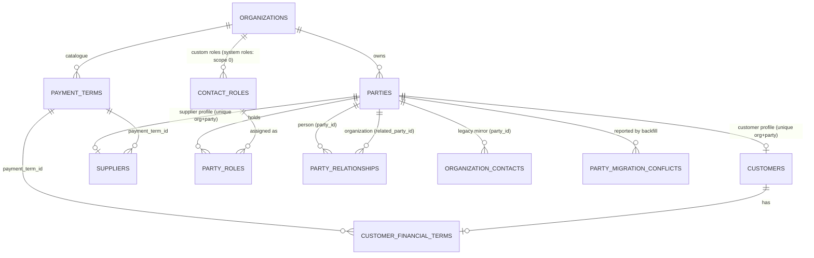

# Unified Contacts — Phase 1 (Backend & Data Architecture)

Status: implemented on `feature/unified-contacts-phase-1-backend`, base `staging` @ `bdec961`. Backend only: no UI, no sidebar change, no deployment.

## 1. Decision

One identity, one record, many roles. A new canonical **Party** holds shared identity. `Customer` and `Supplier` become *commercial profiles* of a party (at most one of each per party and organization, enforced by unique keys). `OrganizationContact` stays as a compatibility layer. Nothing is dropped; every existing id is stable.

Verified against `staging` (audit findings confirmed): `organization_contacts` has one `contact_type` and nullable `customer_id`/`supplier_id`; `customers` and `suppliers` each carried their own copy of name/email/phone/address; `SaveOrganizationContactAction`, `CustomerManager`, `SaveSupplierAction` (+ MCP change services) were three independent write paths; customer terms live in `customer_financial_terms`, supplier terms in `suppliers.default_payment_term_days`.

## 2. Relationship diagram

All party-referencing foreign keys are **composite `(organization_id, id)`**, so a row can never point at a party of another organization at the database level.

## 3. Models and migrations

| Migration | Content |
|---|---|
| `2026_12_02_000001_create_unified_contacts_party_tables` | `parties`, `contact_roles` (+8 seeded system roles), `party_roles`, `party_relationships`, `payment_terms`, `party_migration_conflicts`; nullable `party_id` on `customers`, `suppliers`, `organization_contacts`; nullable `payment_term_id` on `suppliers` and `customer_financial_terms`. |
| `2026_12_02_000002_backfill_parties_and_provision_contact_permissions` | Registers `contacts.roles.manage` and `contacts.payment_terms.manage` (Owner/Admin/General-admin preset), runs `PartyBackfillService`. |

Models: `Party`, `ContactRole`, `PartyRole`, `PartyRelationship`, `PaymentTerm`, `PartyMigrationConflict`; `party()` added to `Customer`, `Supplier`, `OrganizationContact`.

**Identity fields on Party** (all optional except kind + display name): person/organization `kind`, `display_name`, `legal_name`, `email`, `phone`, `whatsapp`, `whatsapp_username`, `address`, `city`, `country_code`, fiscal `ice` / `tax_identifier` / `rc_number`, `notes`, `status` (active/archived). **No banking data** is on a party; `bank_iban` stays on `suppliers` (hidden attribute, own permission) and `PartyIdentitySerializer` is a whitelist that never emits it and shows fiscal identity and profile ids only to viewers holding `contacts.view` / `customers.view` / `suppliers.view`.

**Roles.** System roles are global rows (`organization_scope = 0`, stable `system_key`: `client, supplier, internal, provider, carrier, partner, interlocutor, prospect`; labels Client, Fournisseur, Interne, Prestataire, Transporteur, Partenaire, Interlocuteur, Prospect). Custom roles are organization rows, unique on a normalized name (case/accent/spacing-insensitive) within `(organization_scope, normalized_name)`; a custom name can neither shadow a system role nor another organization's. *Autre* is only an entry mechanism: the typed name is persisted as a custom role (or an existing one is reused). A role is a label and never carries a permission.

**Payment terms.** One organization catalogue (Comptant 0, 30, 60, 90, 120 days, custom delays reusable by name). A reserved `structure` JSON (deposit percent, installments) is shape-validated but **never interpreted**: no second schedule engine. A customer profile and a supplier profile of the same party hold independent terms; assignment keeps the legacy day columns in step so existing readers are unaffected.

## 4. Service / action contracts

| Contract | Permission | Guarantees |
|---|---|---|
| `SavePartyAction::execute(actor, org, data, ?party)` | `contacts.create` / `contacts.update` | Only kind + display name required; update mirrors to legacy rows in the same transaction; archived parties are read-only. |
| `ManagePartyRolesAction::add/remove` | `contacts.update` (+ below) | Idempotent; party row locked. Client ⇒ also `customers.create`; Fournisseur ⇒ also `suppliers.manage`; creating a *new* custom role ⇒ `contacts.roles.manage`. `remove` is a soft deactivation, refused for Client/Fournisseur while money is open. |
| `ActivateCommercialProfileAction::customer/supplier` | `contacts.update` + `customers.create` / `suppliers.manage` | Reuses an existing profile, otherwise creates it; unique `(organization_id, party_id)` is the race backstop (loser re-reads the winner). Ids never change. |
| `LinkPartyRelationshipAction` | `contacts.update` | Person → organization only, same organization, idempotent, never merges identities. |
| `ArchivePartyAction::archive/restore` | `contacts.archive` | Soft; refused while open money exists; never touches profiles/documents. |
| `ManageContactRolesCatalogueAction` | `contacts.roles.manage` | Strict creation (duplicates rejected), system roles protected. |
| `ManagePaymentTermsAction` | `contacts.payment_terms.manage`; assignment: `finance.customers.terms.manage` / `suppliers.manage` | Catalogue + independent customer/supplier assignment. |
| `PartyIdentitySynchronizer` | internal | `apply()` (party→mirrors) and `syncFromLegacy()` (legacy→party→mirrors). |
| `PartyLifecycleGuard::blockers()` | internal | `customer_unpaid_orders`, `customer_opening_balance`, `customer_open_advance`, `supplier_open_obligations`. |

Every mutation above writes an `audit_logs` entry (`party.*`, `contact_role.*`, `payment_term.created`, `customer|supplier.payment_term_assigned`).

## 5. Transitional source of truth (no divergence)

**The Party is authoritative for shared identity.** Every write path funnels through `PartyIdentitySynchronizer`, in one transaction:

* Party edited → mirrored into the linked customer, supplier and identity contacts.
* Legacy customer / supplier / contact saved (web, MCP, POS quick-create — all reuse `CustomerManager`, `SaveSupplierAction`, `SaveOrganizationContactAction`) → its party is created if missing, updated, and mirrored into the *sibling* rows.

Mirrored data is mutable identity only. Issued documents keep their own snapshots and financial rows are never touched (asserted by test: invoice, order and customer position are byte-identical after identity edits). `customers.tax_identifier` has no fixed fiscal meaning, so it seeds a party only when no supplier profile (exact ICE/IF columns) shares it.

## 6. Migration, conflicts and rollback

`PartyBackfillService` is additive and idempotent (rows with a `party_id` are skipped). It only sets the new nullable `party_id`; no legacy row is deleted or changes id.

**Merge only when unambiguous:**

* Supplier + customer → one party iff the same 15-digit ICE belongs to exactly one organization-kind customer and exactly one supplier, and that customer party has no supplier yet.
* Contact + account → adopted iff linked to exactly one account, no job title, name exactly equal to the account name, and no other contact already adopted it.

**Never merged** (kept separate and written to `party_migration_conflicts`, `status = open`): same name or email with a different ICE (`possible_duplicate_identity`), shared email (`shared_email_not_merged`), a contact linked to an account but not identical to it (`contact_linked_to_account_not_identical` — it becomes a person party with an *interlocutor* relationship to the company), a contact linked to both customer and supplier (`contact_linked_to_customer_and_supplier`), an ICE shared by several customers (`ice_shared_by_several_customers`).

Legacy contact types map to roles (`client`, `supplier`, `internal`, `transport→carrier`); legacy `other` gets **no role** and is preserved verbatim in `parties.legacy_contact_type`. A role row is a label; whether a commercial profile exists is `customers/suppliers.party_id`. Exact standard delays (0/30/60/90/120) on existing customer/supplier terms are linked to the catalogue; any other delay stays an untouched number.

**Rollback.** The schema migration's `down()` refuses (clear message) when natively created parties, custom roles or custom payment terms exist; otherwise it drops only the new objects. Parties produced by the backfill are reproducible from the legacy rows. The data migration's `down()` is a deliberate no-op. Recommended procedure: run the backfill once, review the conflict report, then proceed.

## 7. Authorization and isolation

Existing permissions are unchanged. New: `contacts.roles.manage`, `contacts.payment_terms.manage`. Creating a plain contact needs only `contacts.create`; any commercial profile, financial terms, custom role or archive needs its own permission (test-enforced). Cross-organization parties/roles are 404; composite foreign keys enforce it again in the database. Store-level transactional restrictions are untouched (no transactional query was changed).

## 8. Payment terms → invoice due dates (Phase 3 integration plan, nothing built here)

Today: an invoice due date is the invoice date plus the organization default (`invoicePaymentTermDays`); `customer_financial_terms.payment_term_days` is stored and used by credit guards/forecasts but does not set the invoice due date. Phase 3 proposal: resolve a **new** invoice's due date as `explicit override → customer profile payment_term (catalogue) → organization default`, snapshotted on the invoice at issuance. Existing invoices and installments are never recalculated. `structure` (deposit/installments) would feed the *existing* customer installment services, not a new engine. No Moroccan legal-compliance claim is made: the maximum legal payment delays and any B2C/B2B constraints must be confirmed from a verified regulatory source before Phase 3 enforces anything.

## 9. Known limitations

* Phase 1 has no UI and no new routes: the lifecycle is exposed as actions/services for Phase 2.
* Concurrency is proven by the locked party row + unique keys and a deterministic stale-state test on SQLite; a true multi-connection MySQL race test is not included (the repository's `tests/Concurrency` suite is the place to add it in CI).
* The payment-term catalogue is lazily seeded (`ensureDefaults`) for organizations created after the migration.
* Archiving a party does not deactivate its customer/supplier profile flags (they keep their own lifecycle); POS/pickers do not yet filter by party status.
* Legacy `customers.tax_identifier` ↔ `parties` fiscal fields are intentionally not mirrored when a supplier profile shares the party (semantics differ).
* Contacts imported by MCP are synchronized the same way, but MCP has no tool for roles/terms yet.

## 10. Phase 2 handoff

* **Read model:** `PartyIdentitySerializer::toArray()` (roles, profile ids, gated fiscal). Add a list/search endpoint over `parties` with role and kind filters.
* **Write model:** call the actions above from controllers; validate with `SavePartyAction::rules()`. The creation form's "Autre" field maps to `ManagePartyRolesAction::add(..., ['<typed name>'])`.
* **Role picker:** `ContactRoleRegistry::available($org)`.
* **Terms picker:** `PaymentTermCatalogue::list($org)`; custom delay → `ManagePaymentTermsAction::create`.
* **Lifecycle UX:** surface `PartyLifecycleGuard::blockers()` codes before archive/role removal.
* **Conflict review:** list `party_migration_conflicts` (status `open`) and add a "reviewed / merge" workflow (merging is intentionally not automated).
* **Cutover prerequisites before dropping legacy columns (a later phase):** point readers at `parties`, then retire `organization_contacts.customer_id/supplier_id` in favour of `party_relationships`.
